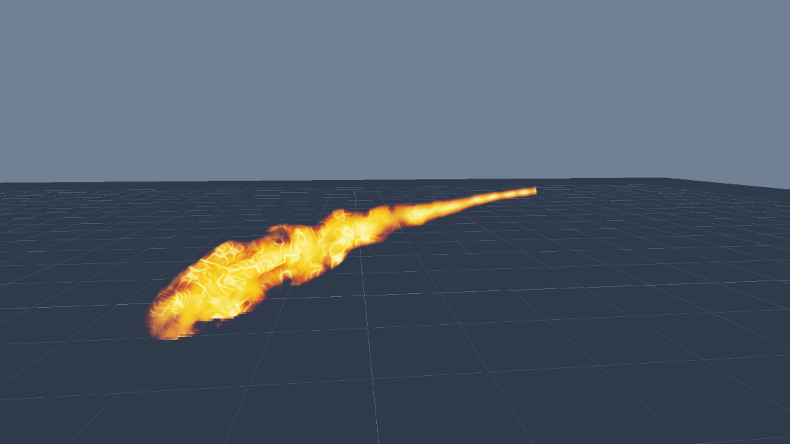

# Curved Volume Lance

By Au Le. Fire API v1, WebGL2, `lance` slot. Classic can continue to supply the ground fire and gameplay heat grid.

## How it works

A seeded emitter launches ballistic particles using the host's speed, gravity and reach. Their flight ages order a tapered lattice that splits at sharp turns. View-aligned slices shade the lattice with a bright core and animated noise, then composite it against the host's scene depth. The flame clears as its particles expire. The swept shape and slicing follow the rendering idea in [Fuller et al.](https://web.cs.ucdavis.edu/~hamann/FullerKrishnanMahrousHamannJoy2006Final03102006.pdf).

`info.js` declares the backend and slot. `index.js` exposes the Fire API lifecycle and restores the render target and `autoClear` after drawing. `emitter.js` owns each instance's particle state. `curved-volume.js` owns the lattice, shader and GPU resources. The [catalog entry](../catalog.js) defers loading the implementation until a host selects it.

## Try it in Valleyward

Play it at [valleyward.app/?firemod=lance-curved-volume](https://valleyward.app/?firemod=lance-curved-volume), or pick
**Curved Volume Lance** under **P → Fire module** in the WebGL2 renderer.

To run it from source, follow the [two-checkout setup](../../CONTRIBUTING.md#testing-locally) and link this Firewraith checkout into Valleyward. Use Valleyward `8a1621b` or a later version that supports the module catalog.

- [Curved Volume with Classic ground fire](http://127.0.0.1:5350/?gpu=webgl2&lance=lance-curved-volume&ground=classic&skipintro=1&fire=smooth)
- [Classic Lance and Classic ground fire](http://127.0.0.1:5350/?gpu=webgl2&lance=classic&ground=classic&skipintro=1&fire=smooth)

Press **3** to equip the Lance. Fire a short shot, hold, turn quickly and release. `__ew.perf().fire.modules` should show `lance-curved-volume` and `classic` in their respective slots with `state: 'loaded'`. Check `__ew.perf().fire.lance` for particle, slice and triangle counts. Run `npm test` from Firewraith to check the module contract and particle lifecycle.

## Tuning

- `NOZZLE_RADIUS` and `BODY_RADIUS` in `curved-volume.js` set the taper endpoints. `BREAK_ANGLE` controls where a fast turn splits the flame.
- `SPACING` in `index.js` sets the slice spacing in meters for High, Medium and Low. Wider spacing draws fewer slices.
- `BIRTH_RATE` and `CAPACITY` in `emitter.js` control the source density and maximum live particles.

## Performance

In the 1920×1080 first-person Valleyward replay with High quality, Classic ground fire and Smooth style, Curved Volume took **5.90 ms p50 / 9.92 ms p95** for combined Lance and ground GPU updates and compositing. Classic in the same scene took **6.15 ms / 8.29 ms**. Chrome 157 with ANGLE Metal on Apple M4, two rounds and 120 paired firing samples per variant. Both exceeded the 4.5 ms target for that workload.
